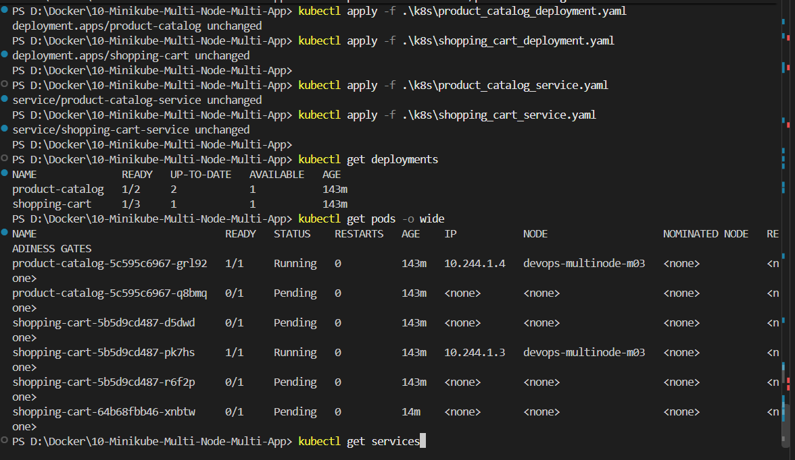
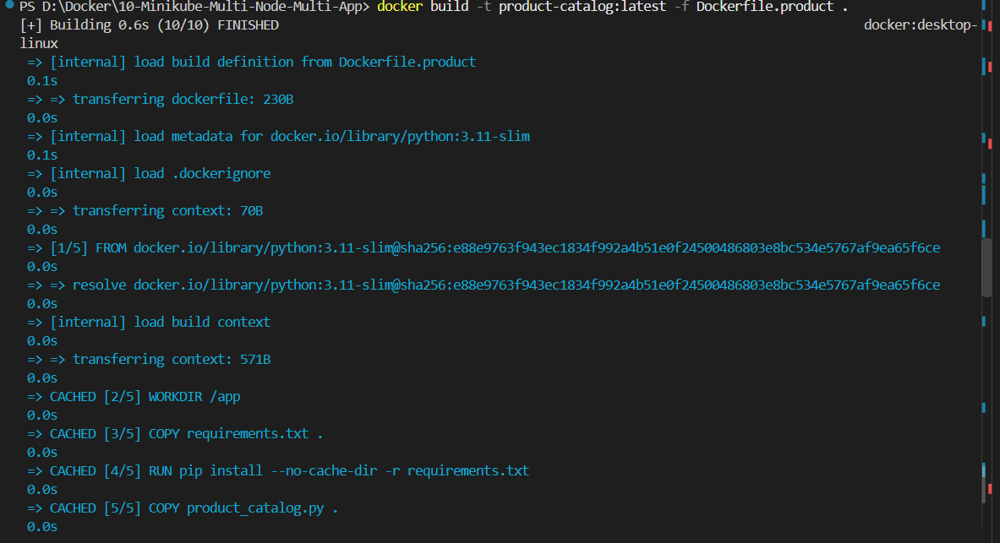
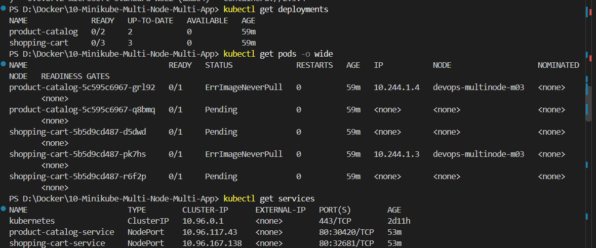
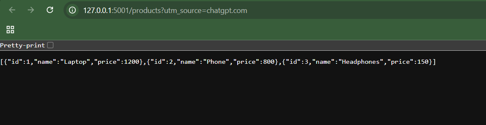
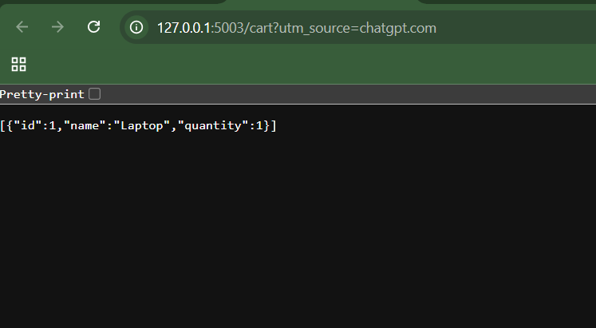
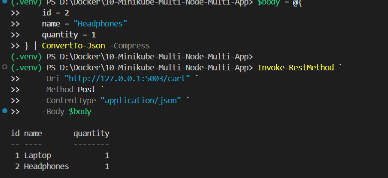

# Exercise 10: Minikube Multi-Node, Multi-App Deployment

## Scenario

This exercise deploys two small Flask services for an e-commerce system:

- **Product Catalog (App A):** returns a product list from `/products`; 2 replicas.
- **Shopping Cart (App B):** reads and adds items using `/cart`; 3 replicas.

Both Deployments use required pod anti-affinity, so replicas of the same app are scheduled on different nodes. The Services expose each app using NodePort.

> **Note for Windows users:** run these commands in VS Code PowerShell with Docker Desktop running. Unlike the Linux/root-specific source example, this guide does not use `--force`. The two Deployments and Services are both in the `default` namespace so each Service can select its corresponding Pods.

## Project structure

```text
10-Minikube-Multi-Node-Multi-App/
├── README.md
├── product_catalog.py
├── shopping_cart.py
├── requirements.txt
├── Dockerfile.product
├── Dockerfile.shopping
├── k8s/
│   ├── product_catalog_deployment.yaml
│   ├── shopping_cart_deployment.yaml
│   ├── product_catalog_service.yaml
│   └── shopping_cart_service.yaml
└── images/
```

## Step 1 — Open and verify the folder

In VS Code, open the `10-Minikube-Multi-Node-Multi-App` folder, then choose **Terminal → New Terminal**:

```powershell
Get-Location
Test-Path .\product_catalog.py
Test-Path .\k8s\product_catalog_deployment.yaml
```

Both `Test-Path` commands should return `True`.

## Step 2 — Start a three-node Minikube cluster

Make sure Docker Desktop is running first.

```powershell
minikube start --nodes=3 -p devops-multinode --driver=docker
minikube -p devops-multinode status
kubectl config use-context devops-multinode
kubectl get nodes -o wide
```

Wait until the three nodes show `Ready`. If you already have a Minikube profile with this name and want to start fresh, deleting the profile also deletes its Kubernetes resources:

```powershell
minikube -p devops-multinode stop
minikube -p devops-multinode delete
minikube start --nodes=3 -p devops-multinode --driver=docker
```

## Step 3 — Build the two Docker images

Run from the project root:

```powershell
docker build -t product-catalog:latest -f Dockerfile.product .
docker build -t shopping-cart:latest -f Dockerfile.shopping .
docker image ls
```

## Step 4 — Load the images into Minikube

```powershell
minikube -p devops-multinode image load product-catalog:latest
minikube -p devops-multinode image load shopping-cart:latest
minikube -p devops-multinode ssh -- docker images
```

Confirm both `product-catalog` and `shopping-cart` images are listed. If your Minikube version/driver does not make a loaded image available to all nodes, follow Minikube's registry add-on workflow for your environment.

## Step 5 — Deploy both applications

```powershell
kubectl apply -f .\k8s\product_catalog_deployment.yaml
kubectl apply -f .\k8s\shopping_cart_deployment.yaml
kubectl rollout status deployment/product-catalog --timeout=180s
kubectl rollout status deployment/shopping-cart --timeout=180s
```

## Step 6 — Create the Services

```powershell
kubectl apply -f .\k8s\product_catalog_service.yaml
kubectl apply -f .\k8s\shopping_cart_service.yaml
kubectl get services
```

## Step 7 — Verify replicas and node distribution

```powershell
kubectl get deployments
kubectl get pods -o wide
kubectl get pods -l app=product-catalog -o wide
kubectl get pods -l app=shopping-cart -o wide
```

Expected: 2 Product Catalog Pods and 3 Shopping Cart Pods. Replicas of the same Deployment should land on separate nodes. If pods remain `Pending`, check `kubectl describe pod <pod-name>`; each app requires three schedulable nodes for its required anti-affinity rule (the catalog uses two of them).

## Step 8 — Open both services

Run each command in a separate VS Code terminal. Keep the terminal open while testing because Minikube may run a service tunnel.

Terminal 1:

```powershell
minikube -p devops-multinode service product-catalog-service
```

Terminal 2:

```powershell
minikube -p devops-multinode service shopping-cart-service
```

Open the URLs printed by Minikube. The Product Catalog URL should return the product list at `/products`; the Shopping Cart URL should respond to `/cart`.

## Step 9 — Test the endpoints

Use the actual URL printed by the `minikube service` command for each service. In PowerShell, use `curl.exe` (not the PowerShell `curl` alias) for the POST request.

Product Catalog:

```powershell
curl.exe http://127.0.0.1:<PRODUCT-CATALOG-PORT>/products
```

Shopping Cart — get current cart:

```powershell
curl.exe http://127.0.0.1:<SHOPPING-CART-PORT>/cart
```

Shopping Cart — add a sample item:

```powershell
curl.exe -X POST http://127.0.0.1:<SHOPPING-CART-PORT>/cart -H "Content-Type: application/json" -d '{"id":1,"name":"Laptop","quantity":1}'
```

Replace the placeholder ports with the ports that Minikube actually prints. The cart is stored in each Flask process's memory, so this example demonstrates service routing and replica deployment, not a production persistent shared cart.

## Troubleshooting

- **`docker` connection error:** start Docker Desktop and wait until the engine is ready.
- **Node not `Ready`:** run `minikube -p devops-multinode status` and `kubectl get nodes`.
- **Pod `ImagePullBackOff` / `ErrImageNeverPull`:** rebuild the image and load it into the named Minikube profile.
- **Pods `Pending`:** run `kubectl describe pod <pod-name>` and inspect scheduling events. Required anti-affinity needs enough ready nodes.
- **Service not reachable:** check `kubectl get endpoints`, ensure Pods are `Ready`, and keep the Minikube service terminal open.
- **PowerShell POST quoting issue:** use `curl.exe` as shown above or send the request from a REST client.

## Screenshots and evidence

Save your real screenshots in `images/` using these exact filenames. The Markdown links below will display them on GitHub once the images are committed.

### 1. Three-node Minikube cluster ready


### 2. Docker images built


### 3. Deployments and Pods distributed across nodes


### 4. Product Catalog endpoint


### 5. Shopping Cart GET endpoint


### 6. Shopping Cart POST endpoint


## Commit and push to GitHub

If this folder is inside your existing cloned DevOps repository, run Git commands from that repository root (the folder containing its `.git` directory):

```powershell
git status
git add .\10-Minikube-Multi-Node-Multi-App\
git commit -m "Add Exercise 10 Minikube multi-node multi-app deployment"
git push origin main
```

If the folder is not in the clone yet, copy it into the repository root before running these commands. Do not run `git init` again inside the exercise folder.

## Cleanup (optional)

```powershell
kubectl delete -f .\k8s\product_catalog_service.yaml --ignore-not-found
kubectl delete -f .\k8s\shopping_cart_service.yaml --ignore-not-found
kubectl delete -f .\k8s\product_catalog_deployment.yaml --ignore-not-found
kubectl delete -f .\k8s\shopping_cart_deployment.yaml --ignore-not-found
minikube -p devops-multinode stop
```

## Reference

Original exercise: https://github.com/SunagP/DevOps-Lab/blob/main/Exercises/10-Minikube-Multi-Node-Multi-App-Minikube-Deployment.md
