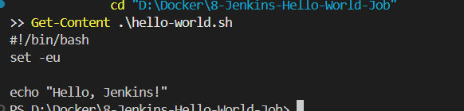
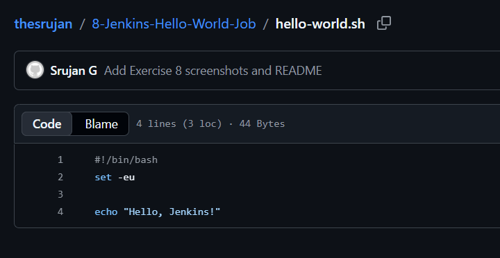
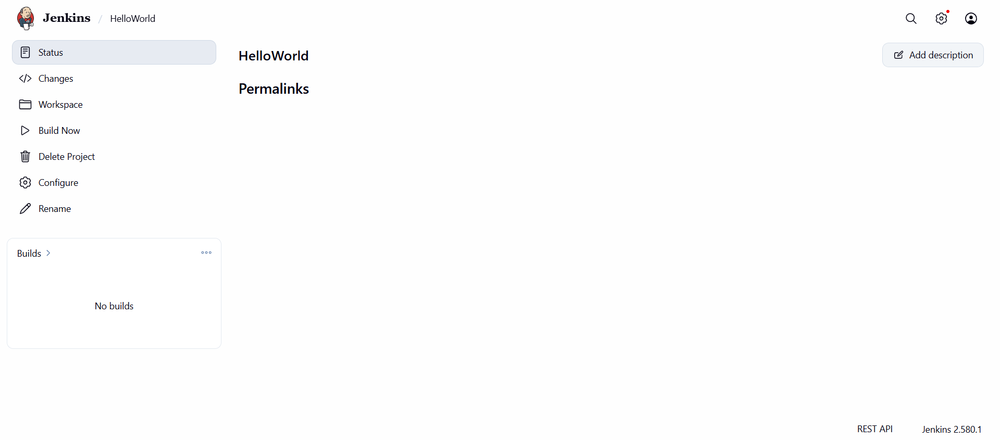
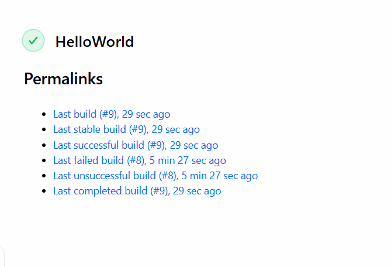
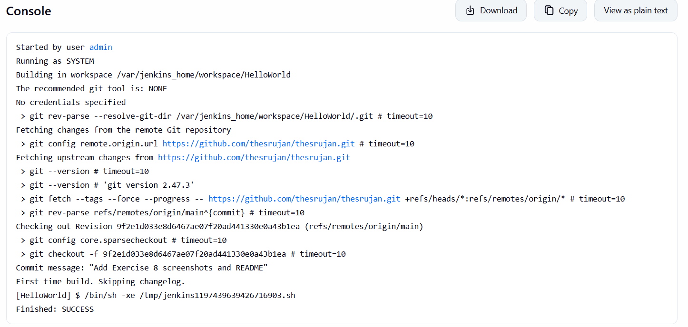

# Exercise 8: Jenkins Hello World Job

This exercise creates a small shell script in GitHub and runs it from a Jenkins **Freestyle project**. The expected console output includes `Hello, Jenkins!` and `Finished: SUCCESS`.

## Project structure

```text
8-Jenkins-Hello-World-Job/
├── README.md
├── hello-world.sh
├── .gitignore
└── images/
    └── README.md
```

## Prerequisites

- Git installed on Windows.
- Jenkins running and accessible in a browser, normally at `http://localhost:8080`.
- Jenkins has the Git plugin installed.
- This folder is committed to a GitHub repository that Jenkins can access. In this example, the source repository is your main DevOps exercises repository, `https://github.com/thesrujan/thesrujan.git`. If your repo is private, add a GitHub credential in Jenkins; don't paste a personal access token into this README or a screenshot.

## Step 1 — Check the shell script

The `hello-world.sh` file contains:

```bash
#!/bin/bash
set -eu

echo "Hello, Jenkins!"
```

Jenkins runs this script inside its Linux environment using `sh`, so the Windows executable-bit setting is not required for this job.

## Step 2 — Commit the exercise to GitHub

If this exercise folder is inside your existing cloned Git repository, run these commands from the repository root (the folder containing the root `README.md`):

```powershell
git status
git add .\8-Jenkins-Hello-World-Job\
git commit -m "Add Exercise 8 Jenkins Hello World job"
git push origin main
```

If the commit reports `nothing to commit`, check that the folder and script have been copied into the cloned repository and saved.

## Step 3 — Open Jenkins

1. Open `http://localhost:8080` and sign in.
2. From the Jenkins dashboard, click **New Item**.
3. Name the job `HelloWorld`.
4. Select **Freestyle project**, then click **OK**.
5. In **Description**, enter `Hello World! Jenkins job.`

## Step 4 — Configure Source Code Management

1. Under **Source Code Management**, select **Git**.
2. For **Repository URL**, enter:

   ```text
   https://github.com/thesrujan/thesrujan.git
   ```

3. If the repository is public, leave credentials as **None**. If private, configure Jenkins credentials securely.
4. Under **Branches to build**, use `*/main` if your default branch is `main`.

> If you instead create the standalone `devops-sample-code` repository from the original exercise, use that repository's clone URL and set the build command in Step 5 to `sh hello-world.sh`.

## Step 5 — Add the build step

1. Under **Build Steps**, click **Add build step** → **Execute shell**.
2. Since this guide checks out the complete `thesrujan/thesrujan` repository and the script is in this exercise folder, enter:

   ```bash
   sh 8-Jenkins-Hello-World-Job/hello-world.sh
   ```

3. Click **Save**.

## Step 6 — Run the job and verify output

1. Open the `HelloWorld` job.
2. Click **Build Now**.
3. When the build finishes, click the build number in **Build History**.
4. Click **Console Output**.
5. Confirm the console contains:

   ```text
   Hello, Jenkins!
   Finished: SUCCESS
   ```

## Troubleshooting

- **Repository checkout fails:** Open the job configuration and verify the repository URL, branch (`*/main`), Git plugin, and credentials for private repositories.
- **`sh` or `git` is not found:** Jenkins needs a Linux-compatible shell for **Execute shell** and Git installed/available to its environment for SCM checkout. Check the Jenkins container logs and image configuration.
- **Script not found:** Make sure the build step uses `sh 8-Jenkins-Hello-World-Job/hello-world.sh` when checking out the main exercises repository. If using the standalone repository, use `sh hello-world.sh`.
- **Build is still running or failed:** Open **Console Output** and read the first error before retrying.

## Screenshots and evidence

Capture your own successful results, then save the screenshots in this folder's `images/` directory using these names:

### 1. Shell script created



### 2. Script committed to GitHub



### 3. Jenkins Freestyle job configuration



### 4. Jenkins build success



### 5. Jenkins console output



The image links display when the corresponding real PNG files are added and pushed. Do not use generated/example images as proof of execution.

## Reference

Original exercise: <https://github.com/SunagP/DevOps-Lab/blob/main/Exercises/8-Jenkins-Hello-World-Job.md>
