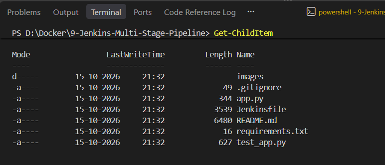
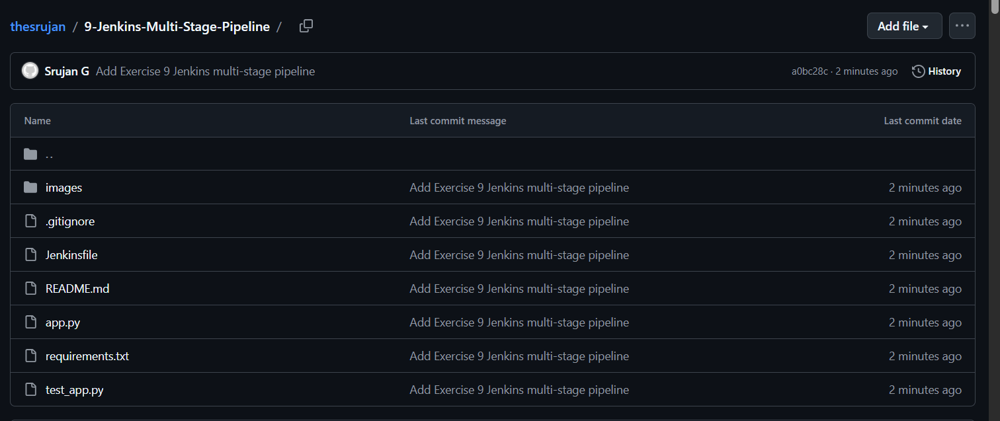
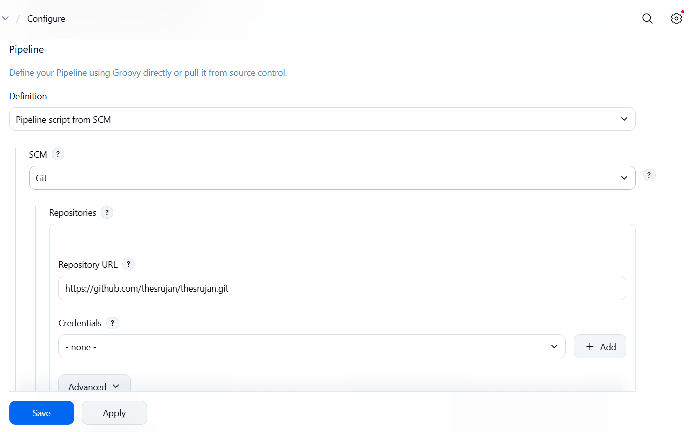
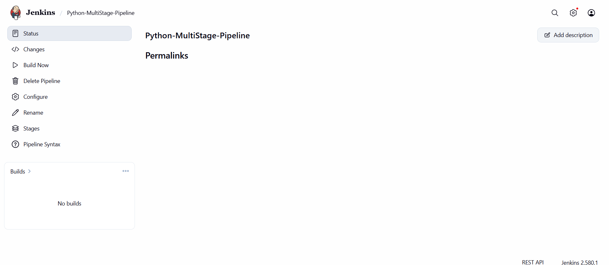
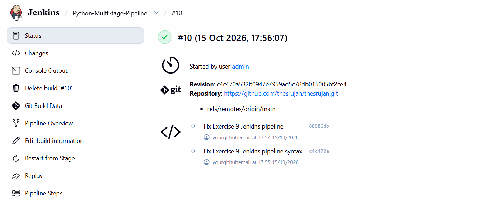
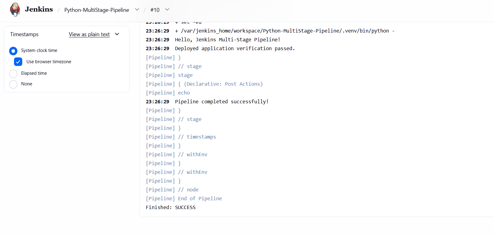

# Exercise 9: Jenkins Multi-Stage Pipeline

## Objective

Build a small Flask application and use a Jenkins Pipeline to run multiple stages: **Build**, **Test**, **Deploy**, **Run Application**, and **Test Application**. The deploy step copies the app into a mock deployment directory inside the Jenkins workspace; it is a learning exercise, not a production deployment.

## Project structure

```text
9-Jenkins-Multi-Stage-Pipeline/
├── README.md
├── app.py
├── requirements.txt
├── test_app.py
├── Jenkinsfile
├── .gitignore
└── images/
    └── README.md
```

## Prerequisites

- Jenkins is running and you can sign in at `http://localhost:8080`.
- Jenkins has the **Pipeline** and **Git** plugins enabled.
- The Jenkins agent that runs the job has `git`, `python3`, and Python's `venv` support available. For a Jenkins controller running in Docker, check with `docker exec jenkins python3 --version` and `docker exec jenkins python3 -m venv --help`.
- This `Jenkinsfile` uses Linux shell steps (`sh`), matching the common Jenkins Docker-on-Linux setup.

> If your Jenkins container does not have Python or `venv`, the pipeline will fail in the Build stage. Install these in a persistent/custom Jenkins image or configure a Linux agent with Python 3; installing packages temporarily in a container may be lost when the container is recreated.

## Step 1 — Check the project locally

Open this folder in VS Code. In the PowerShell terminal, verify the files exist:

```powershell
Test-Path .\app.py
Test-Path .\requirements.txt
Test-Path .\test_app.py
Test-Path .\Jenkinsfile
```

Optional local test, if Python is installed on your Windows computer:

```powershell
py -m venv .venv
.\.venv\Scripts\python.exe -m pip install -r requirements.txt
.\.venv\Scripts\python.exe -m unittest -v
```

## Step 2 — Push the exercise to your existing GitHub repository

This project is intended to be a subfolder of your existing `thesrujan/thesrujan` DevOps repository. Copy `9-Jenkins-Multi-Stage-Pipeline` into the root of your cloned repository so it sits alongside the other exercise folders. Then run these commands from the repository root:

```powershell
git status
git add .\9-Jenkins-Multi-Stage-Pipeline\
git commit -m "Add Exercise 9 Jenkins multi-stage pipeline"
git push origin main
```

## Step 3 — Make sure Jenkins has Python

The Jenkinsfile runs `python3 -m venv`, installs dependencies, and then runs tests. If Jenkins is your Docker container named `jenkins`, verify the tools from PowerShell:

```powershell
docker exec jenkins python3 --version
docker exec jenkins python3 -m venv --help
```

If these commands fail, use a Linux Jenkins agent with Python 3 and `python3-venv`, or build a custom Jenkins image with those packages installed. The exact package installation method depends on the image/agent you use. Avoid installing packages in a temporary container if you need them to survive recreation.

## Step 4 — Create a Pipeline job in Jenkins

1. Open `http://localhost:8080` and sign in.
2. Click **New Item**.
3. Enter `Python-MultiStage-Pipeline` and select **Pipeline**.
4. Click **OK**.
5. In the Pipeline section, set **Definition** to **Pipeline script from SCM**.
6. Choose **Git** and set Repository URL to:

   ```text
   https://github.com/thesrujan/thesrujan.git
   ```

7. Under **Branches to build**, set the branch specifier to `*/main`.
8. Set **Script Path** to:

   ```text
   9-Jenkins-Multi-Stage-Pipeline/Jenkinsfile
   ```

9. Click **Save**, then click **Build Now**.

If the repository is private, configure Jenkins credentials for GitHub. Do not put a password or token directly in the Jenkinsfile or README.

## Step 5 — Follow the stages

The Jenkinsfile runs these stages in order:

1. **Build** — creates a virtual environment, installs Flask, and compiles Python files.
2. **Test** — runs the unit tests in `test_app.py`.
3. **Deploy** — copies `app.py` and `requirements.txt` to `python-app-deploy` under the Jenkins workspace.
4. **Run Application** — starts Flask on port `18080` inside the Jenkins agent for pipeline verification.
5. **Test Application** — sends an HTTP request and checks the response text.

The deployed test server runs inside the Jenkins agent/container; this exercise does not publish it to your Windows host. Check the pipeline Console Output for the response and the final `Finished: SUCCESS` message.

## Screenshots and evidence

Capture your own successful results and save them in this folder using the filenames below. The links will render the images in GitHub after the PNG files are added and pushed.

### 1. Python application files in VS Code



### 2. Exercise files in GitHub



### 3. Jenkins Pipeline job configuration



### 4. Jenkins Pipeline stages completed



### 5. Unit tests passed



### 6. Mock deployment directory created



Suggested Windows screenshot shortcut: `Win + Shift + S`.

## Troubleshooting

- **`Couldn't find any revision to build`** — under Jenkins Git configuration, set Branches to build to `*/main` (not `*/master`).
- **`python3: not found`** — the Jenkins agent needs Python 3 installed.
- **`No module named venv` / ensurepip error** — install the matching `python3-venv` package on the Linux agent, or use an agent image that includes it.
- **`Permission denied` on shell steps** — make sure Jenkins is running a Linux/Unix agent and the repository checkout is accessible to the Jenkins user.
- **Port 18080 already in use** — stop a previous exercise process or change `APP_PORT` in the Jenkinsfile and update the HTTP URLs to match.

## Cleanup

The temporary Flask server is started in the Jenkins agent workspace for demonstration. If a build is interrupted before cleanup, stop the process inside the agent or recreate the workspace. The mock deploy folder is located at `${WORKSPACE}/python-app-deploy`.

## Reference

Original exercise: [Jenkins Multi-Stage Pipeline Exercise](https://github.com/SunagP/DevOps-Lab/blob/main/Exercises/9-Jenkins-Multi-Stage-Pipeline.md)
