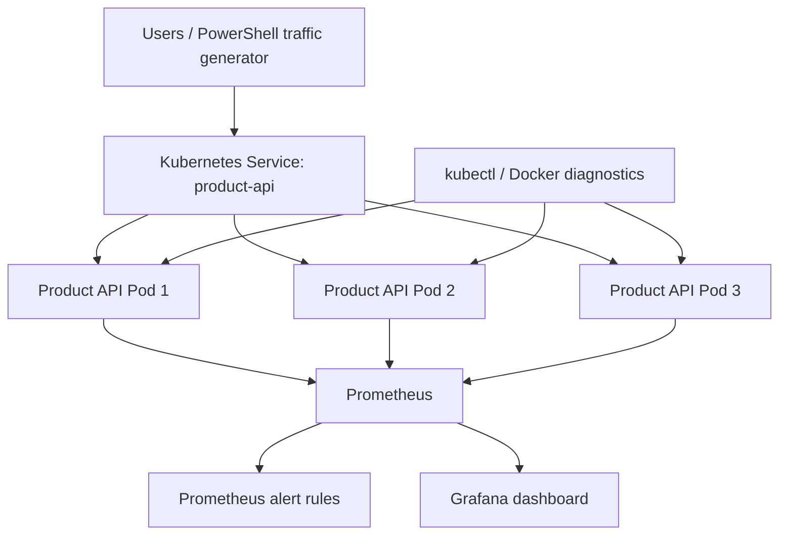

# Question 9 — Quick-Commerce Monitoring and Incident Diagnosis

**Coverage:** Exercises 2, 3, 4 and 6 (Flask, Kubernetes Deployments/Services/replicas, Docker, Prometheus and Grafana).

## Scenario and objective

A quick-commerce company runs an API that checks product availability. During peak demand, response time can increase. This lab deploys the API in Kubernetes with three replicas, generates repeated requests, monitors per-Pod application CPU and memory plus API metrics in Grafana, configures Prometheus alerts, deletes a Pod to simulate a fault, diagnoses the issue, and verifies recovery.

## Architecture



Prometheus discovers annotated Pods through the Kubernetes API and scrapes each Pod's `/metrics` endpoint. The Flask process exports its process CPU time and resident memory, along with request count, request latency, and product availability metrics. Grafana visualizes those Prometheus metrics.

> **Metric scope:** The CPU and memory panels in this project show the Flask application process inside each Pod (`process_cpu_seconds_total` and `process_resident_memory_bytes`). They are useful per-Pod application-process indicators, not whole-node metrics. The optional `kubectl top pods` step shows Kubernetes Pod resource usage through Metrics Server.

## Project structure

```text
Question-9-Quick-Commerce-Monitoring/
├── README.md
├── WRITEUP.md
├── .gitignore
├── app/
│   ├── app.py
│   ├── requirements.txt
│   └── Dockerfile
├── k8s/
│   ├── 00-namespace.yaml
│   ├── 01-product-api.yaml
│   ├── 02-product-api-service.yaml
│   ├── 03-prometheus-rbac.yaml
│   ├── 04-prometheus-config.yaml
│   ├── 05-prometheus-alerts.yaml
│   ├── 06-prometheus.yaml
│   ├── 07-grafana-provisioning.yaml
│   ├── 08-grafana-dashboard.yaml
│   └── 09-grafana.yaml
├── monitoring/grafana/dashboard.json
├── scripts/generate-traffic.ps1
└── images/
```

## Prerequisites (Windows + VS Code)

- Docker Desktop running with the **Linux container** engine.
- Minikube and kubectl installed and available on `PATH`.
- PowerShell terminal in VS Code.
- Recommended: Docker Desktop resources of at least 4 CPUs and 6 GB memory for the app, Prometheus and Grafana together. A smaller machine may need lower limits or fewer monitoring components.

Check the tools:

```powershell
docker version
minikube version
kubectl version --client
git --version
```

## Step 1 — Start a dedicated local Kubernetes cluster

This uses a separate single-node Minikube profile named `quick-commerce-q9` so it does not overwrite a different lab profile. The assignment requires at least three **application replicas**; it does not require three Kubernetes nodes.

```powershell
minikube start -p quick-commerce-q9 --driver=docker
kubectl config use-context quick-commerce-q9
kubectl get nodes -o wide
```

Wait until the node status is `Ready`.

## Step 2 — Build and load the Flask image

Run from the project root (the folder containing `app`, `k8s`, and this README):

```powershell
docker build -t quick-commerce-api:1.0 -f .\app\Dockerfile .\app
minikube -p quick-commerce-q9 image load quick-commerce-api:1.0
```

The Kubernetes manifest uses `imagePullPolicy: Never`, so the image must be loaded into Minikube before the Deployment is created.

## Step 3 — Deploy the Product Availability API with three replicas

Apply the namespace, app, service, and monitoring components in order:

```powershell
kubectl apply -f .\k8s\00-namespace.yaml
kubectl apply -f .\k8s\01-product-api.yaml
kubectl apply -f .\k8s\02-product-api-service.yaml
kubectl apply -f .\k8s\03-prometheus-rbac.yaml
kubectl apply -f .\k8s\04-prometheus-config.yaml
kubectl apply -f .\k8s\05-prometheus-alerts.yaml
kubectl apply -f .\k8s\06-prometheus.yaml
kubectl apply -f .\k8s\07-grafana-provisioning.yaml
kubectl apply -f .\k8s\08-grafana-dashboard.yaml
kubectl apply -f .\k8s\09-grafana.yaml
```

Wait for each Deployment:

```powershell
kubectl rollout status deployment/product-api -n quick-commerce --timeout=180s
kubectl rollout status deployment/prometheus -n quick-commerce --timeout=180s
kubectl rollout status deployment/grafana -n quick-commerce --timeout=180s
```

Check resources and Pod placement:

```powershell
kubectl get deployments,pods,services -n quick-commerce -o wide
kubectl get endpoints product-api -n quick-commerce
```

Expected: `product-api` shows **3/3 available** and three Pods show `1/1 Running`. The scheduler may place them on the same node in this single-node profile; the task requires three replicas, not three nodes.

## Step 4 — Access the Product API

Start port forwarding in a dedicated PowerShell terminal and leave it open:

```powershell
kubectl port-forward service/product-api 5001:80 -n quick-commerce
```

Open this URL in your browser:

- `http://127.0.0.1:5001/api/products/1001/availability`

Example response:

```json
{
  "product_id": "1001",
  "product_name": "Milk",
  "available": true,
  "stock": 18,
  "served_by_pod": "product-api-..."
}
```

Other example product IDs: `1002` (Bread, currently unavailable), `1003` (Eggs), and `1004` (Fruit Box). Health: `http://127.0.0.1:5001/health`.

## Step 5 — Generate repeated requests (peak traffic simulation)

Keep the Product API port-forward running. Open a **second** PowerShell terminal and run:

```powershell
1..150 | ForEach-Object {
    Invoke-RestMethod -Uri "http://127.0.0.1:5001/api/products/1001/availability?work_ms=20" -TimeoutSec 10 | Out-Null
}
Write-Host "Completed 150 product availability requests."
```

The optional `work_ms=20` parameter simulates a small amount of work per request (bounded by the API) so the request-rate and latency charts are easier to observe. It is only for this local lab.

Alternatively run:

```powershell
.\scripts\generate-traffic.ps1
```

## Step 6 — Open Prometheus and verify targets and alert rules

In a **third** PowerShell terminal:

```powershell
kubectl port-forward service/prometheus 9090:9090 -n quick-commerce
```

Open:

- Targets: `http://127.0.0.1:9090/targets` — all three `quick-commerce-api` Pod targets should become **UP**.
- Alerts: `http://127.0.0.1:9090/alerts` — view the configured alert rules.
- Query: `http://127.0.0.1:9090/graph` — useful queries are shown below.

Example PromQL queries:

```promql
# Application process CPU (CPU-seconds per second) per Pod
rate(process_cpu_seconds_total{job="quick-commerce-api"}[1m])

# Application process resident memory in MiB per Pod
process_resident_memory_bytes{job="quick-commerce-api"} / 1024 / 1024

# Requests per second by Pod
sum by (pod) (rate(product_api_requests_total{job="quick-commerce-api"}[1m]))

# Number of healthy scrape targets
sum(up{job="quick-commerce-api"})
```

## Step 7 — Open Grafana dashboard

In a **fourth** PowerShell terminal:

```powershell
kubectl port-forward service/grafana 3000:3000 -n quick-commerce
```

Open `http://127.0.0.1:3000`.

Local lab login (configured in the Grafana Deployment):

- Username: `admin`
- Password: `admin`

The Prometheus data source and **Quick Commerce API Monitoring** dashboard are provisioned automatically. The dashboard contains per-Pod CPU, memory, request rate, availability, scrape target count, and p95 request latency panels.

**Security note:** `admin/admin` is only for a local disposable lab. Do not use these credentials in a shared or production environment.

## Step 8 — Trigger and justify the memory alert

The Prometheus rule `ProductApiHighMemoryUsage` fires when an individual Flask process stays above **70 MiB RSS for 30 seconds**. Each API container has a **192 MiB memory limit**. The 70 MiB threshold is an early-warning signal (about 36% of the configured limit), leaving time to investigate before the container approaches its memory limit. It is a lab threshold, not a universal production threshold.

Find one API Pod:

```powershell
kubectl get pods -n quick-commerce -l app=quick-commerce-api
```

Copy one running Pod name. In a **fifth** terminal, port-forward directly to that Pod (replace `<POD_NAME>`):

```powershell
kubectl port-forward pod/<POD_NAME> 5003:5000 -n quick-commerce
```

In another terminal, allocate demo memory in that specific Pod:

```powershell
Invoke-RestMethod -Uri "http://127.0.0.1:5003/demo/allocate-memory?mb=48"
```

Wait about 45–60 seconds, then refresh `http://127.0.0.1:9090/alerts` and the Grafana dashboard. The memory alert should become **Firing** if the process RSS exceeds the threshold for the configured duration. The endpoint is demo-only and bounded to 48 MiB.

To release the demo allocation, call:

```powershell
Invoke-RestMethod -Uri "http://127.0.0.1:5003/demo/release-memory"
```

If the process RSS does not fall after release (the Python allocator may retain memory), delete that Pod as in the next step; the Deployment will create a fresh Pod.

## Step 9 — Simulate a Pod fault and diagnose it

Delete one API Pod to simulate a workload fault. First select a Pod name:

```powershell
kubectl get pods -n quick-commerce -l app=quick-commerce-api
```

Then delete one Pod (replace the example name):

```powershell
kubectl delete pod <POD_NAME> -n quick-commerce
```

Watch the Deployment create a replacement:

```powershell
kubectl get pods -n quick-commerce -l app=quick-commerce-api -w
```

Press `Ctrl+C` after the replacement is `Running` and `1/1 Ready`.

Useful incident-diagnosis commands:

```powershell
# Pod state, node and restart count
kubectl get pods -n quick-commerce -o wide

# Detailed events and scheduling / probe failures
kubectl describe pod <POD_NAME> -n quick-commerce

# Application logs
kubectl logs <POD_NAME> -n quick-commerce --tail=50

# Recent namespace events
kubectl get events -n quick-commerce --sort-by=.lastTimestamp

# Service backends (should list ready Pod IPs)
kubectl get endpoints product-api -n quick-commerce

# Desired and available replicas
kubectl get deployment product-api -n quick-commerce
```

Docker node-container checks (for problems with the Minikube host container itself):

```powershell
docker ps --filter "name=quick-commerce-q9"
docker inspect quick-commerce-q9 --format '{{.State.Status}}'
```

### Distinguishing workload failure from connectivity failure

- **Workload failure:** a Pod is `Pending`, `CrashLoopBackOff`, `ImagePullBackOff`, or not Ready. Use `kubectl describe pod`, events and `kubectl logs` to find the reason.
- **Service/connectivity failure:** Pods are `Running` and Ready but the API cannot be reached. Check `kubectl get endpoints product-api -n quick-commerce`, confirm the Service selector and target port, and verify that the port-forward terminal is still running.
- **Node/Docker failure:** a Minikube node is `NotReady` or the Docker node container is stopped/unresponsive. Check `kubectl get nodes`, `minikube -p quick-commerce-q9 status`, `docker ps` and `docker inspect`.

## Step 10 — Verify recovery

After deleting a Pod, check that the Deployment is back to three replicas and all endpoints are restored:

```powershell
kubectl rollout status deployment/product-api -n quick-commerce --timeout=180s
kubectl get deployment product-api -n quick-commerce
kubectl get pods -n quick-commerce -l app=quick-commerce-api -o wide
kubectl get endpoints product-api -n quick-commerce
```

Use the existing Product API port-forward and refresh the availability endpoint. In Prometheus, `sum(up{job="quick-commerce-api"})` should return `3` after recovery. Grafana should again show three healthy scrape targets and updated CPU/memory/request metrics.

## Optional — Kubernetes Pod resource usage with Metrics Server

This adds a second way to inspect Pod resource usage:

```powershell
minikube addons enable metrics-server -p quick-commerce-q9
kubectl top pods -n quick-commerce
```

Metrics Server may take a minute to become ready. `kubectl top` is a Kubernetes resource view; the Grafana dashboard in this project uses Prometheus-scraped application-process metrics.

## Screenshot evidence

Save genuine screenshots from your own execution in this project's `images/` folder. The README image links below will render on GitHub after the PNG files are committed.

### 1. Kubernetes application deployment and three replicas


### 2. Product availability API response


### 3. Repeated traffic generation


### 4. Grafana CPU and memory dashboard


### 5. Prometheus alert firing


### 6. Pod fault and automatic replacement


### 7. Diagnosis output


### 8. Service recovery evidence


## Cleanup (optional)

Delete only the resources created for this question:

```powershell
kubectl delete namespace quick-commerce
```

To remove the dedicated local cluster as well (this deletes that Minikube profile and its local resources):

```powershell
minikube delete -p quick-commerce-q9
```

## Viva points

- **Why three replicas?** To provide capacity and keep the API available if one Pod fails.
- **What replaces a deleted Pod?** The Deployment's ReplicaSet creates a replacement to restore the desired replica count.
- **What does Prometheus do?** Discovers and scrapes metrics endpoints and evaluates alert rules.
- **What does Grafana do?** Queries Prometheus and displays metrics in dashboards.
- **How do you distinguish workload and connectivity failures?** Inspect Pod state, events and logs, then inspect Service endpoints and the port-forward path.
- **Why 70 MiB memory alert?** It is an early warning below the 192 MiB container memory limit, leaving headroom for investigation; production thresholds should be based on observed baseline and service SLOs.

## GitHub submission

Copy this complete folder into your existing cloned DevOps repository (next to the other exercise folders), then run from the repository root:

```powershell
git status
git add .\Question-9-Quick-Commerce-Monitoring\
git commit -m "Add Question 9 quick-commerce monitoring and incident diagnosis"
git pull --rebase origin main
git push origin main
```
