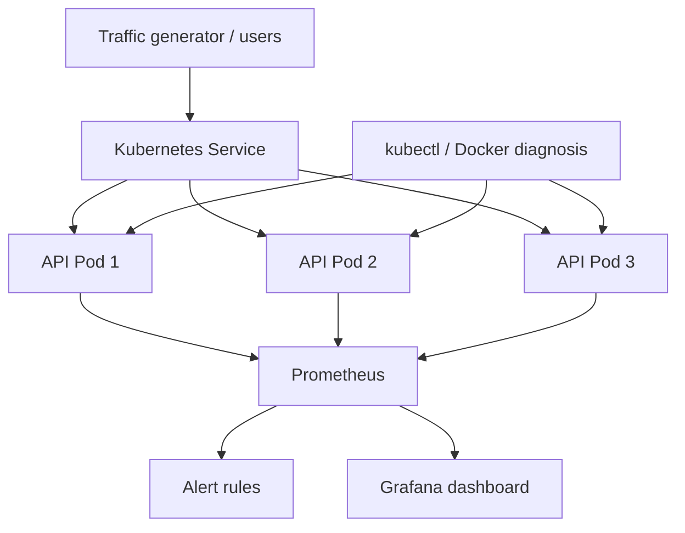

# Question 9 — Pre-execution Write-up

## Aim

Build and monitor a quick-commerce product-availability API, deploy it in Kubernetes with at least three replicas, generate repeated requests, visualize application CPU and memory and API/Pod metrics in Grafana, create a resource alert, simulate a Pod failure, diagnose the issue, and verify recovery.

## Approach

1. Implement a Flask API that accepts a product identifier and returns availability, stock, and the name of the Pod serving the request.
2. Add `/health` for Kubernetes probes and `/metrics` for Prometheus scraping. Export request count, request latency, product availability and process CPU/memory metrics.
3. Build a Docker image and load it into Minikube.
4. Create a Kubernetes Deployment with three replicas, resource requests/limits and health probes. Expose the Deployment through a ClusterIP Service.
5. Deploy Prometheus with Kubernetes Pod discovery and RBAC so it can scrape each annotated API Pod.
6. Add Prometheus alert rules. The memory alert fires when a process remains above 70 MiB RSS for 30 seconds. The container limit is 192 MiB, so this threshold provides an early warning before the configured limit.
7. Provision Grafana with Prometheus as its data source and a dashboard showing CPU, memory, request rate, product availability, scrape target count and p95 latency.
8. Generate repeated availability requests to simulate peak demand.
9. Delete one API Pod to simulate a fault. Use Kubernetes status, events, logs, Service endpoints and Docker node-container inspection to decide whether the problem is a workload, Service/connectivity or node/Docker issue.
10. Verify the Deployment recreates the Pod, three healthy Prometheus targets return, the Service has endpoints, and the API responds again.

## Tools and technologies

| Tool / technology | Role |
|---|---|
| Python and Flask | Implement the product availability API |
| Docker | Package the API into a container image |
| Minikube | Run a local Kubernetes cluster |
| Kubernetes Deployment and ReplicaSet | Keep three API Pods available and recreate a deleted Pod |
| Kubernetes Service | Provide a stable endpoint for the API Pods |
| kubectl | Deploy, scale, inspect, diagnose and recover Kubernetes resources |
| Prometheus | Scrape per-Pod metrics and evaluate alert rules |
| Grafana | Visualize Prometheus metrics in a dashboard |
| Prometheus client / psutil | Export request metrics and application-process CPU/memory metrics |
| PowerShell | Generate repeated HTTP requests and operate the lab on Windows |

## Schematic diagram

## Expected demonstration

- Product availability API returns a JSON response for a product identifier.
- Three API Pods become Ready and are reachable through one Service.
- Repeated requests increase the request counters and appear in Prometheus/Grafana.
- Grafana displays per-Pod application process CPU, memory, request rate and availability.
- A Prometheus memory alert can be demonstrated with the bounded lab-only memory allocation endpoint.
- Deleting one Pod causes the Deployment/ReplicaSet to create a replacement.
- Kubernetes status, events, logs, endpoints and Docker inspection are used to distinguish workload failure from a connectivity or node issue.
- The application and three healthy scrape targets recover after the fault.

## Threshold justification

The sample warning threshold is 70 MiB resident memory for 30 seconds. The API container limit is 192 MiB. The threshold is deliberately below the container limit to provide an early-warning interval. This is a lab demonstration threshold; a production threshold should be selected from measured baseline usage, workload characteristics and the service's reliability objectives.

## Notes and limitations

The Grafana CPU and memory charts use Linux process metrics exposed by the Flask process collector, labelled by Kubernetes Pod discovery. They represent the API process in each Pod, rather than total node utilization. The optional Metrics Server step (`kubectl top pods`) gives Kubernetes Pod-level resource readings. The `/demo/allocate-memory` endpoint is enabled only for this local assignment and is bounded to 48 MiB; it should be disabled or removed in a production application.
